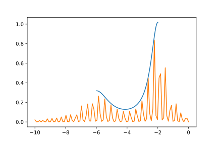

Spectrojotometer.
=================

This package is a set of tools to determine, by means of ab initio 
simulations, the value of the coupling constants in a Heisenberg-like effective 
magnetic model for a given magnetic system.


A ready to use version for MS Windows is available [here](http://www2.fisica.unlp.edu.ar/~matera/visualbond/)

Installation
============

spectrojotometer requires Python 3.11 or later. To install it from the
repository:

    pip install git+https://github.com/QILPCM-IFLP-CONICET/spectrojotometer

or, from a copy of the repository, `pip install .`. For development, an
editable installation with the test dependencies:

    pip install -e ".[test]"
    pytest

The tests of the graphical interface need a display; they are skipped
without one (on a headless machine, run them with `xvfb-run pytest`).


Loading models: conventional vs. primitive cell
=================================================

`magnetic_model_from_file` / `magnetic_model_from_cif` accept an optional
`primitive_cell` parameter (default `False`):

* `primitive_cell=False` (default, historical behaviour): if the CIF's
  symmetry loop lists extra operators (e.g. the centering translations of
  an F, I, C, A or B centered lattice), the atoms of the asymmetric unit
  are expanded to fill the conventional cell before building the model.

* `primitive_cell=True`: atoms are kept exactly as declared in the CIF's
  `_atom_site` loop (never expanded), and the model's Bravais vectors are
  switched to a primitive basis built from the symmetry operators, which
  must all be pure translations (a centered lattice, not a general
  point-group symmetry). Bonds to symmetry images must use the standard
  CIF `_geom_bond_site_symmetry_2` code (e.g. `2_555` for the second
  listed symmetry operator), not extra invented atom labels. This gives
  a much smaller model (e.g. 4 atoms instead of 16 for an F-centered
  spinel lattice like ZnCr2O4), which is useful when enumerating spin
  configurations.

Example:

    from spectrojotometer.model_io import magnetic_model_from_file
    model = magnetic_model_from_file(
        "zncr2o4.cif", magnetic_atoms=("Cr",), primitive_cell=True
    )

This is also available in the Tkinter GUI (the "Use primitive cell
(centering symmetries)" checkbox in the File menu) and in the
visualbondweb API (the `primitive_cell` field on `POST /model/upload`,
and `POST /model/{session_id}/primitive_cell` to toggle it mid-session).

Important: this setting only stays in effect if every reload of the
model keeps using it. Saving a compact (primitive-cell) model with
`save_cif` and then re-loading it with `primitive_cell=False` (or with
a version of the tool that predates this parameter) silently and
permanently expands it back to the conventional cell — there is no way
to recover the compact form afterwards other than starting again from
the original CIF with the symmetry operators still declared.


Estimating the couplings and their uncertainties
================================================

The effective model
-------------------

Each magnetic configuration is a list `σ = [σ_1, ..., σ_n]` with
`σ_i ∈ {0, 1}` (spin up / down), and `s_i = 1 - 2 σ_i = ±1`. Its
energy is modeled as

    E(σ) = E_0 - Σ_k J_k Σ_{(i,j) ∈ bond k} s_i s_j

so a positive `J_k` favours parallel alignment. The spin length is
absorbed into the couplings: the `spin_repr` and `g_lande_factors` stored
in the model are written back to CIF files, but they do not enter the fit.

For a set of `M` configurations with computed energies `E`, this is a
linear system `A · (J, E_0) = E`. `MagneticModel.coefficient_matrix(confs)`
returns `A`, and `MagneticModel.compute_couplings` solves it.

The compatibility region
------------------------

The DFT energies are only known within a tolerance `δE`. The couplings
compatible with the data are those that reproduce **every** energy
within that tolerance:

    P = { J : max_i |(A·J - E)_i| ≤ δE }

`P` is a convex polytope. The reported value of each coupling is the
center of a box around `P`, and its error bar is the half width of that
box. `compute_couplings` offers three ways to obtain the box, selected
with the `method` argument:

* `"exact"` (default): the exact bounding box of `P`, by linear
  programming (the minimum and maximum of each `J_k` over `P`). It costs
  `2K` small linear programs for `K` parameters: tens of milliseconds for
  typical models.
* `"montecarlo"`: points are drawn uniformly inside the ellipsoid
  `|A·(J - J_LS)|² ≤ M δE² - |r|²`, which contains `P` (`J_LS` is the
  least-squares solution and `r` its residual), and only those inside
  `P` are kept. The box of the kept points is always **inside** the exact
  one, and the underestimation grows with the number of couplings, as
  the acceptance rate drops quickly. It is mainly useful to get a cloud
  of compatible couplings.
* `"ellipse"`: the bounding box of that ellipsoid, computed analytically.
  It always **contains** the exact box.

All three are invariant under a change of energy units: rescaling the
energies and the tolerance by the same factor rescales the results by
that factor.

```python
from spectrojotometer.model_io import (magnetic_model_from_file,
                                       read_spin_configurations_file)

model = magnetic_model_from_file("examples/example1.cif")
energies, confs, labels = read_spin_configurations_file(
    "examples/example1.spin", model)

js, djs, chis, rate = model.compute_couplings(confs, energies, err_energs=1e-3)
for name, j, dj in zip(model.bonds, js, djs):
    print(name, "=", j, "+/-", dj)
```

`compute_couplings` returns four values:

* `js`: the center of the box for each coupling, in the order of
  `model.bonds`. The last entry is not `E_0` but the **average energy**
  of the configurations: the coupling columns of `A` are centered, which
  decouples the couplings from the base energy.
* `djs`: the half widths of the box. A coupling that the configurations
  do not determine (`P` is unbounded along it) gets `nan`, with its
  value set to 0. If `P` is empty, i.e. no set of couplings reproduces
  all the energies within `δE` and the model is incompatible with the
  data, all the entries are `-1`.
* `chis`: the residuals of the least-squares solution relative to the
  tolerance, `(A·J_LS - E) / δE`. Values larger than 1 in absolute
  value point to configurations that the model cannot reproduce.
* `rate`: the Monte Carlo acceptance rate (`1.0` for the other methods,
  `0.0` if the model is incompatible).

Monte Carlo runs accept `mcsteps` (number of samples), `mcsizefactor`
(scale of the sampling ellipsoid; keep it at 1) and `rng` (a seed or a
`numpy.random.Generator`, for reproducible results). The exact box is
also available directly as
`spectrojotometer.tools.compatibility_box(A, E, δE)`.

The older `montecarlo=True/False` argument is still accepted, and means
`method="montecarlo"` / `method="ellipse"`.

### Constraints on combinations of couplings

The box only bounds each coupling separately. The region usually is
elongated along some combinations of them, which are better determined
than the individual couplings.
`model.bound_inequalities(confs, energies, err_energs)` returns, for each
direction determined by the data, a tuple `(v, center, half_width)`
meaning

    |v · J - center| ≤ half_width

with `v` normalized so that its largest component is ±1. These
constraints come from the same ellipsoid that contains `P`, so they are
satisfied by every compatible set of couplings.


Choosing the configurations
---------------------------

Before computing any energy, the configurations can be chosen so that
the couplings come out as precise as possible. If every energy is known
within a tolerance `δE`, each coupling `J_k` is known within
`δE * h_k`, where

    h_k = max { |J_k| : max_i |(A·J)_i| ≤ 1 }

depends only on the configurations: it is the half width of the box of
the compatibility region for zero residual and unit tolerance.
`model.error_bounds(confs)` returns the `h_k`, and `model.cost(confs)`
their maximum (`np.inf` if some coupling is not determined).
`error_bounds(confs, method="ellipse")` gives instead the bound from the
ellipsoid that contains the region: a closed formula, about a thousand
times faster, and never smaller than the exact value.

`optimize_independent_set` and `find_optimal_configurations` look for the
configurations with the smallest `cost`, using the ellipse bound while
searching. Given the number of new configurations, they return that many;
otherwise they start from the smallest set that determines every
coupling, and add configurations while each one reduces the bound by at
least 5% (`min_improvement`).

The ratio between the largest and the smallest singular values of `A`
(the condition number) is not used: it measures how relative errors are
amplified, while the question here is how large the absolute error of
each coupling is.


Logging
========

spectrojotometer reports progress and diagnostics through the standard
`logging` module, under the `spectrojotometer` logger (with one child
logger per module, e.g. `spectrojotometer.magnetic_model`). It never
prints diagnostics nor configures logging by itself: the application
decides what to show and where. In a script, for instance:

```python
import logging

logging.basicConfig(level=logging.WARNING)
logging.getLogger("spectrojotometer").setLevel(logging.INFO)  # or DEBUG
```

Warnings report problems (e.g. a model incompatible with the energies,
or bonds skipped while reading a CIF file), info messages report
progress, and debug messages dump internal details (coefficient
matrices, positions, bond lists).

The command line tools print their results to stdout and show warnings
on stderr; `-v` adds the progress messages and `-vv` the detailed
diagnostics. In visualbond, the messages appear in the panel at the
bottom of the window, and *Edit → Detailed log messages* shows the
diagnostics too.


Tools in the package and workflow:
==================================


Installing the package provides these commands:

* bond_generator, optimize-configurations and evaluate_cc, which form
  the basic workflow;
* map_configs, which maps spin configurations between two models;
* print_equations, which prints the equations of a set of
  configurations in plain text, LaTeX or Wolfram format;
* visualbond, the graphical interface.

Each command accepts --help, and -v / -vv to show progress and
diagnostic messages. They can also be run as
python -m spectrojotometer.cli.<command> (with underscores). All of
them are described below.


*) bond_generator: 

   usage: bond_generator [-h] [-d [value]] [--rmin [value]] [--rmax [value]] [-v]
                         modelfile outfile

   From an standard cif file, produces a new cif file containing information
   about the bonds that defines a Heisenberg magnetic effective model. If the
   input file has already information about bonds, the output file contains both
   the bonds in the input as well as the new generated bonds.

   positional arguments:
     modelfile             load atomic positions from a model file. It can be
                           specified by a cif or a Wien2k struct file
     outfile               Name of the outputfile.

   options:
     -h, --help            show this help message and exit
     -d [value], --discretization [value]
                           the tolerance in considering two distances as the
                           same.
     --rmin [value]        the minimal distance between atoms of the bond
     --rmax [value]        the maximal distance between atoms of the bond
     -v, --verbose         Show progress messages (-v) or detailed diagnostics
                           (-vv).


As an example, by run 

   bond_generator --rmin 0 --rmax 3.1 --discretization .02  example1.cif example1-nnn.cif

   for the example1.cif file in the examples folder creates example1-nnn.cif, with two couplings,
   J0 (distance 2.94) and J1 (distance 3.08). The model can be modified by hand with a text editor.

   Mind the size of the cell: with n magnetic sites there are 2^(n-1) distinct configurations, so
   at most 2^(n-1) - 1 couplings can be determined. example1.cif has 3 sites: with --rmax 4.9 the
   model would have four couplings, which no choice of configurations could determine (the
   programs below report an infinite error bound). Larger models need a larger cell.


*) optimize-configurations

    usage: optimize-configurations [-h] [--known [known configuration file]]
                                   [--start [start file]] [-n numconfs]
                                   [-u updatesize] [--it iterations] [-v]
                                   modelfile outfile

    Generate spin configurations that determine the coupling constants of a model
    with the smallest errors

    positional arguments:
      modelfile             load atomic positions from a cif file
      outfile               Name of the outputfile. If "-" is provided, the output
                            is printed to the standard output.

    options:
      -h, --help            show this help message and exit
      --known [known configuration file]
                            file with the set of configurations that we want to
                            increase
      --start [start file]  A file containing an initial guess for the target
                            configurations.
      -n numconfs           number of new configurations to be generated. If not
                            given, the smallest set that determines every
                            coupling, enlarged while each extra configuration
                            reduces the largest error of a coupling by at least 5%
      -u updatesize         number of random configurations to be generate on each
                            step
      --it iterations       number of iterations
      -v, --verbose         Show progress messages (-v) or detailed diagnostics
                            (-vv).

As an example, by run

   optimize-configurations example1-nnn.cif optconfs1.out
   
   on the example1-nnn.cif generated by bond_generator, creates optconfs1.out, with the magnetic
   configurations whose energies determine the couplings with the smallest errors (here, three
   configurations, and a largest error per unit error in the energies of 1.0). The program also
   writes a recovery file, example1-nnn-resume.tmp, which can be used to continue the search:

   optimize-configurations --start example1-nnn-resume.tmp example1-nnn.cif optconfs1.out

   To know which configurations would be most useful to simulate once a set of them has already been
   simulated, run

   optimize-configurations --known optconfs1.out example1-nnn.cif optconfs2.out

   In this case, the program looks for the configurations that best complement those in optconfs1.out.
   Here it proposes none: the only configuration left, [0, 0, 0], would not reduce the errors. Unless
   the number of new configurations is given with -n, a configuration is proposed only if it reduces
   the largest error of a coupling by at least 5%.


*) evaluate_cc

    From a set of energies and magnetic configurations, estimates the
    coupling constants of a model, with error bars given by a box around
    the compatibility region (see "Estimating the couplings and their
    uncertainties" above).

    usage: evaluate_cc [-h] [-t [value]] [-m {exact,montecarlo,ellipse}]
                       [--mcsteps [value]] [-e] [-x] [-v]
                       modelfile [input file]

    From a set of energies and magnetic configurations, estimates the coupling
    constants of a model.

    positional arguments:
      modelfile             load atomic positions from a model file.
      [input file]          file containing evaluated energies and magnetic
                            configurations.

    options:
      -h, --help            show this help message and exit
      -t [value], --tolerance [value]
                            Provides the estimated error for the energies.
      -m {exact,montecarlo,ellipse}, --method {exact,montecarlo,ellipse}
                            How to bound the compatibility region: exact box by
                            linear programming (default), Monte Carlo sampling
                            (inner estimate) or the bounding box of an ellipsoid
                            containing it (outer estimate).
      --mcsteps [value]     Number of Monte Carlo samples (only with --method
                            montecarlo).
      -e, --equations       Prints the resulting equations.
      -x, --showchi         Prints the list of errors in the predicted
                            configuration energy.
      -v, --verbose         Show progress messages (-v) or detailed diagnostics
                            (-vv).

    In the input file, each line consists of the energy of a magnetic
    configuration, followed by the configuration as a list [0,1,0,...].
    Anything after a # is considered a comment. Configurations whose
    energy is nan are ignored. For example:

    # Energy  Configuration  Label
    143121.12   [0,0,0,0,0,0,0]  # Ferro up
    143121.02   [1,1,0,0,1,1,1]  # Disorder1
    143121.24   [1,0,1,1,1,1,0]  # Disorder2
    143121.12   [1,1,1,1,1,1,1]  # Ferro down

    Running, with the files in the examples folder,

    evaluate_cc examples/example1.cif examples/example1.spin

    prints (after some diagnostic messages)

    # Results (method: exact):
    ===========
    <E> =  49022.002225000004  (average energy of the configurations)
    J0  = ( -1.0  +/- 2.2222222168326238 ) *  0.00022499999977299012
    max relative error: 0.03333334461785853  in configuration  1

    Each coupling is shown as (value +/- error) * scale, where the scale
    is the largest coupling in absolute value. <E> is the average energy
    of the configurations (see compute_couplings). Here the three
    configurations do not determine J0 beyond the tolerance (the error
    bar is larger than the value): more configurations, or a smaller
    tolerance, are needed.

    With -x, the program also prints, for each configuration, the
    difference between the input energy and the one predicted by the
    model, relative to the tolerance. Once enough configurations have
    been evaluated, this checks the validity of the effective model:
    differences larger than 1 mean that the model cannot reproduce the
    input spectrum. If no set of couplings reproduces all the energies
    within the tolerance, the couplings are marked as (incompatible).


*) map_configs

    usage: map_configs [-h] [--tol tolerance] [--fill {0,1}] [-v]
                       modelfile1 modelfile2 conffile outfile

    Translate the spin configurations of a source model into configurations of a
    target model: each site of the target takes the spin of the site of the source
    at the same position (up to a translation of the source lattice). The energies
    are scaled by the ratio between the number of sites of the target and of the
    source cells.

    positional arguments:
      modelfile1       model file of the source model
      modelfile2       model file of the target model
      conffile         configurations of the source model
      outfile          output file; "-" prints to the standard output

    options:
      -h, --help       show this help message and exit
      --tol tolerance  largest distance between matching sites (default 0.1)
      --fill {0,1}     spin for the sites of the target without counterpart in the
                       source (by default, such sites are an error)
      -v, --verbose    Show progress messages (-v) or detailed diagnostics (-vv).

    For example, mapping the configurations of example1 onto the same
    model (each site onto itself):

    map_configs examples/example1.cif examples/example1.cif examples/example1.spin -

    # site map (target <- source): [0, 1, 2]
    49022.0027	[0, 0, 0]	# 0
    49022.0022	[1, 0, 0]	# 1
    49022.0018	[0, 1, 0]	# 2

    The output is a configuration file: it can be used as input of the
    other commands. A site of the target model without counterpart in the
    source model is an error, unless --fill gives the spin to use.


*) print_equations

    usage: print_equations [-h] [--format format] [-v] modelfile conffile

    From an standard cif or wien2k struct file, and a list of configurations,
    prints the list of equations for the coupling constants

    positional arguments:
      modelfile        load atomic positions from a model file for the source
                       model
      conffile         configs in the src model

    options:
      -h, --help       show this help message and exit
      --format format  output format
      -v, --verbose    Show progress messages (-v) or detailed diagnostics (-vv).

    For example,

    print_equations examples/example1.cif examples/example1.spin

    # Equations:
    - 2.0 * J0 +  E_0=E_1  #  0
       E_0=E_2  #  1
      2.0 * J0 +  E_0=E_3  #  2


   


