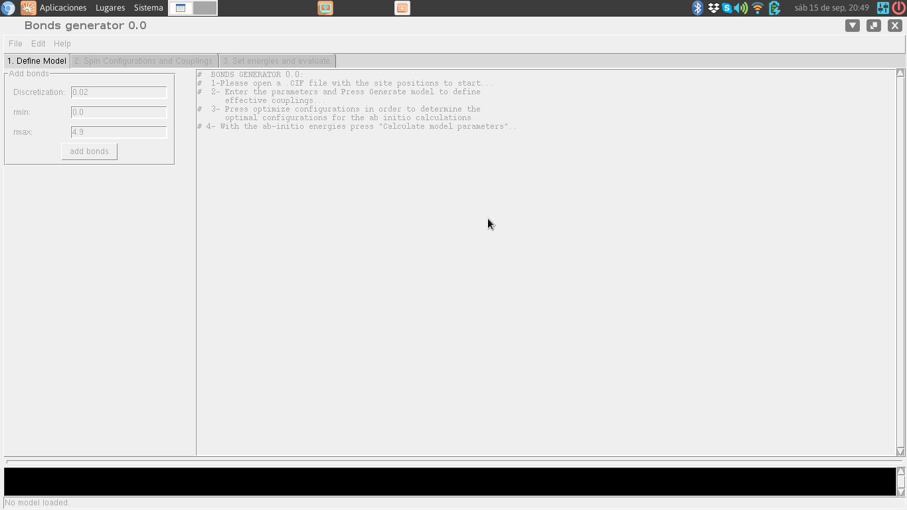
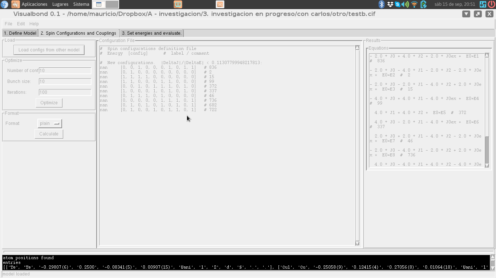
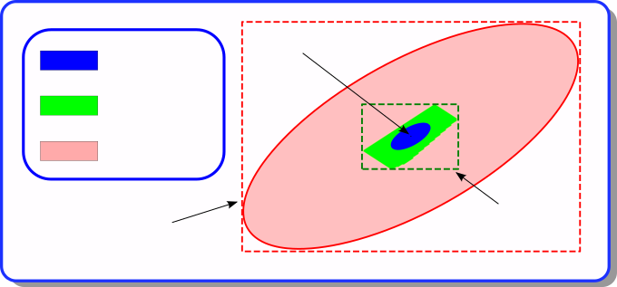

Spectrojotometer.
==================

This package is a set of tools to determine, by means of ab initio 
simulations, the value of the coupling constants in a Heisenberg-like effective 
magnetic model for a given magnetic system.

Installation
============

spectrojotometer requires Python 3.11 or later. To install it from the
repository:

    pip install git+https://github.com/QILPCM-IFLP-CONICET/spectrojotometer

or, from a copy of the repository, `pip install .`. For development, an
editable installation with the test dependencies:

    pip install -e ".[test]"
    pytest

The tests of the graphical interface need a display; they are skipped
without one (on a headless machine, run them with `xvfb-run pytest`).

Loading models: conventional vs. primitive cell
=================================================

`magnetic_model_from_file` / `magnetic_model_from_cif` accept an optional
`primitive_cell` parameter (default `False`). See the main README for
details; in short, `primitive_cell=True` keeps only the atoms declared
in the CIF's asymmetric unit (e.g. 4 instead of 16 for ZnCr2O4) and
switches the model's Bravais vectors to a primitive basis, instead of
expanding atoms to fill the conventional cell.

WIEN2k `.struct` files are read too. Their lengths are in bohr unless the
file says `unit=ang`, and the model is in angstrom, like the ones read
from CIF files; for centred lattices the reader adds the atoms related by
the centring. See the main README.

Visual Bond
===========

Visual Bond is a graphic interfase for the tools in the spectrojotometer package.

Estimating parameter uncertainties
==================================

The DFT energies are only known within a tolerance δE (the *Energy
tolerance* field). The couplings compatible with the data are those that
reproduce **every** computed energy within that tolerance. They form a
convex polytope in the space of parameters, the *compatibility polytope*
(green in the figure). The value reported for each coupling is the
center of the smallest box that contains the polytope, and its error bar
is the half width of the box (dashed green: *uncertainty in parameters*).

The polytope always lies between two ellipses centered at the
least-squares solution: a lower bound (blue), contained in it, and an
upper bound (red), which contains it. The *Error bound method* selector
chooses how the box is obtained:

* **Exact box (linear programming)**, the default: the exact box of the
  polytope, obtained by minimizing and maximizing each coupling over it.
* **Monte Carlo (inner estimate)**: points are drawn uniformly inside the
  upper-bound ellipse, and only those inside the polytope are kept. The
  box of the kept points is always inside the exact box, and it
  underestimates it more as the number of couplings grows. The
  acceptance rate (the fraction of points kept) is printed with the
  results. *Num. samples* sets the number of points; leave *Size factor*
  at 1.
* **Quadratic bound (outer estimate)**: the box of the upper-bound
  ellipse (dashed red). It always contains the exact box.

The results also list *region constraints*: inequalities on
combinations of couplings, `|v·J − c| < δ`, which are often much tighter
than the individual error bars, because the polytope is usually
elongated.

If no set of couplings reproduces all the energies within the tolerance
(the polytope is empty), the couplings are marked as *incompatible*:
either the tolerance is too small, or the model lacks some relevant
coupling. A coupling that the configurations with known energies do not
fix is shown as *undetermined*: add configurations that involve it.

Terminal Tools in the package and workflow:
============================================

Installing the package provides these commands:

* bond_generator, optimize-configurations and evaluate_cc, which form
  the basic workflow;
* map_configs, which maps spin configurations between two models;
* print_equations, which prints the equations of a set of
  configurations in plain text, LaTeX or Wolfram format;
* visualbond, the graphical interface.

Each command accepts --help, and -v / -vv to show progress and
diagnostic messages. They can also be run as
python -m spectrojotometer.cli.<command> (with underscores). All of
them are described below.

*) bond_generator: 

   usage: bond_generator [-h] [-d [value]] [--rmin [value]] [--rmax [value]] [-v]
                         modelfile outfile

   From an standard cif file, produces a new cif file containing information
   about the bonds that defines a Heisenberg magnetic effective model. If the
   input file has already information about bonds, the output file contains both
   the bonds in the input as well as the new generated bonds.

   positional arguments:
     modelfile             load atomic positions from a model file. It can be
                           specified by a cif or a Wien2k struct file
     outfile               Name of the outputfile.

   options:
     -h, --help            show this help message and exit
     -d [value], --discretization [value]
                           the tolerance in considering two distances as the
                           same.
     --rmin [value]        the minimal distance between atoms of the bond
     --rmax [value]        the maximal distance between atoms of the bond
     -v, --verbose         Show progress messages (-v) or detailed diagnostics
                           (-vv).

As an example, by run 

   bond_generator --rmin 0 --rmax 3.1 --discretization .02  example1.cif example1-nnn.cif

   for the example1.cif file in the examples folder creates example1-nnn.cif, with two couplings,
   J0 (distance 2.94) and J1 (distance 3.08). The model can be modified by hand with a text editor.

   Mind the size of the cell: with n magnetic sites there are 2^(n-1) distinct configurations, so
   at most 2^(n-1) - 1 couplings can be determined. example1.cif has 3 sites: with --rmax 4.9 the
   model would have four couplings, which no choice of configurations could determine (the
   programs below report an infinite error bound). Larger models need a larger cell.

*) optimize-configurations

    usage: optimize-configurations [-h] [--known [known configuration file]]
                                   [--start [start file]] [-n numconfs]
                                   [-u updatesize] [--it iterations] [-v]
                                   modelfile outfile

    Generate spin configurations that determine the coupling constants of a model
    with the smallest errors

    positional arguments:
      modelfile             load atomic positions from a cif file
      outfile               Name of the outputfile. If "-" is provided, the output
                            is printed to the standard output.

    options:
      -h, --help            show this help message and exit
      --known [known configuration file]
                            file with the set of configurations that we want to
                            increase
      --start [start file]  A file containing an initial guess for the target
                            configurations.
      -n numconfs           number of new configurations to be generated. If not
                            given, the smallest set that determines every
                            coupling, enlarged while each extra configuration
                            reduces the largest error of a coupling by at least 5%
      -u updatesize         number of random configurations to be generate on each
                            step
      --it iterations       number of iterations
      -v, --verbose         Show progress messages (-v) or detailed diagnostics
                            (-vv).

As an example, by run

   optimize-configurations example1-nnn.cif optconfs1.out
   
   on the example1-nnn.cif generated by bond_generator, creates optconfs1.out, with the magnetic
   configurations whose energies determine the couplings with the smallest errors (here, three
   configurations, and a largest error per unit error in the energies of 1.0). The program also
   writes a recovery file, example1-nnn-resume.tmp, which can be used to continue the search:

   optimize-configurations --start example1-nnn-resume.tmp example1-nnn.cif optconfs1.out

   To know which configurations would be most useful to simulate once a set of them has already been
   simulated, run

   optimize-configurations --known optconfs1.out example1-nnn.cif optconfs2.out

   In this case, the program looks for the configurations that best complement those in optconfs1.out.
   Here it proposes none: the only configuration left, [0, 0, 0], would not reduce the errors. Unless
   the number of new configurations is given with -n, a configuration is proposed only if it reduces
   the largest error of a coupling by at least 5%.

*) evaluate_cc

    From a set of energies and magnetic configurations, estimates the
    coupling constants of a model, with error bars given by a box around
    the compatibility region (see "Estimating parameter uncertainties"
    above).

    usage: evaluate_cc [-h] [-t [value]] [-m {exact,montecarlo,ellipse}]
                       [--mcsteps [value]] [-e] [-x] [-v]
                       modelfile [input file]

    From a set of energies and magnetic configurations, estimates the coupling
    constants of a model.

    positional arguments:
      modelfile             load atomic positions from a model file.
      [input file]          file containing evaluated energies and magnetic
                            configurations.

    options:
      -h, --help            show this help message and exit
      -t [value], --tolerance [value]
                            Provides the estimated error for the energies.
      -m {exact,montecarlo,ellipse}, --method {exact,montecarlo,ellipse}
                            How to bound the compatibility region: exact box by
                            linear programming (default), Monte Carlo sampling
                            (inner estimate) or the bounding box of an ellipsoid
                            containing it (outer estimate).
      --mcsteps [value]     Number of Monte Carlo samples (only with --method
                            montecarlo).
      -e, --equations       Prints the resulting equations.
      -x, --showchi         Prints the list of errors in the predicted
                            configuration energy.
      -v, --verbose         Show progress messages (-v) or detailed diagnostics
                            (-vv).

    In the input file, each line consists of the energy of a magnetic
    configuration, followed by the configuration as a list [0,1,0,...].
    Anything after a # is considered a comment. Configurations whose
    energy is nan are ignored. For example:

    # Energy  Configuration  Label
    143121.12   [0,0,0,0,0,0,0]  # Ferro up
    143121.02   [1,1,0,0,1,1,1]  # Disorder1
    143121.24   [1,0,1,1,1,1,0]  # Disorder2
    143121.12   [1,1,1,1,1,1,1]  # Ferro down

    Running, with the files in the examples folder,

    evaluate_cc examples/example1.cif examples/example1.spin

    prints (after some diagnostic messages)

    # Results (method: exact):
    ===========
    <E> =  49022.002225000004  (average energy of the configurations)
    J0  = ( -1.0  +/- 2.2222222168326238 ) *  0.00022499999977299012
    max relative error: 0.03333334461785853  in configuration  1

    Each coupling is shown as (value +/- error) * scale, where the scale
    is the largest coupling in absolute value. <E> is the average energy
    of the configurations. Here the three
    configurations do not determine J0 beyond the tolerance (the error
    bar is larger than the value): more configurations, or a smaller
    tolerance, are needed.

    With -x, the program also prints, for each configuration, the
    difference between the input energy and the one predicted by the
    model, relative to the tolerance. Once enough configurations have
    been evaluated, this checks the validity of the effective model:
    differences larger than 1 mean that the model cannot reproduce the
    input spectrum. If no set of couplings reproduces all the energies
    within the tolerance, the couplings are marked as (incompatible).

*) map_configs

    usage: map_configs [-h] [--tol tolerance] [--method {auto,position,structure}]
                       [--model-out cif file] [--fill {0,1}] [-v]
                       modelfile1 modelfile2 conffile outfile

    Translate the spin configurations of a source model into configurations of a
    target model: each site of the target takes the spin of the site of the source
    at the same position (up to a translation of the source lattice). The energies
    are scaled by the ratio between the number of sites of the target and of the
    source cells. Configurations that are not periodic with the lattice of the
    target (when it is smaller than the source cell) cannot be represented: they
    are written as comments.

    positional arguments:
      modelfile1            model file of the source model
      modelfile2            model file of the target model
      conffile              configurations of the source model
      outfile               output file; "-" prints to the standard output

    options:
      -h, --help            show this help message and exit
      --tol tolerance       largest distance between matching sites (default 0.1)
      --method {auto,position,structure}
                            how to match the sites: comparing positions (both
                            models in the same frame), aligning the structures
                            with pymatgen's StructureMatcher (different origin,
                            orientation or cell), or auto: positions if every site
                            is found, otherwise the alignment (default)
      --model-out cif file  also save the source model rewritten in the cell and
                            order of sites of the target (its own positions and
                            couplings) to this CIF file
      --fill {0,1}          spin for the sites of the target without counterpart
                            in the source (by default, such sites are an error)
      -v, --verbose         Show progress messages (-v) or detailed diagnostics
                            (-vv).

    For example, mapping the configurations of example1 onto the same
    model (each site onto itself):

    map_configs examples/example1.cif examples/example1.cif examples/example1.spin -

    # site map (target <- source): [0, 1, 2]
    49022.0027	[0, 0, 0]	# 0
    49022.0022	[1, 0, 0]	# 1
    49022.0018	[0, 1, 0]	# 2

    The output is a configuration file: it can be used as input of the
    other commands. A site of the target model without counterpart in the
    source model is an error, unless --fill gives the spin to use. When the
    cell of the target is smaller (e.g. the source is a supercell of it),
    only the configurations periodic with the target lattice are mapped.
    If the two models are not described in the same frame (different
    origin, orientation or choice of cell), the sites are matched by
    aligning the structures with pymatgen's StructureMatcher.

    With --model-out, map_configs also writes the source model rewritten in
    the cell and order of sites of the target: its own positions (e.g. those
    of a distorted phase) and couplings, with one site per site of the
    target, so that the configurations of the target apply to it directly
    (magnetic_model.equivalent_model; in visualbond, "Export transformed
    model..." in the import window).

*) print_equations

    usage: print_equations [-h] [--format format] [-v] modelfile conffile

    From an standard cif or wien2k struct file, and a list of configurations,
    prints the list of equations for the coupling constants

    positional arguments:
      modelfile        load atomic positions from a model file for the source
                       model
      conffile         configs in the src model

    options:
      -h, --help       show this help message and exit
      --format format  output format
      -v, --verbose    Show progress messages (-v) or detailed diagnostics (-vv).

    For example,

    print_equations examples/example1.cif examples/example1.spin

    # Equations:
    - 2.0 * J0 +  E_0=E_1  #  0
       E_0=E_2  #  1
      2.0 * J0 +  E_0=E_3  #  2

   

